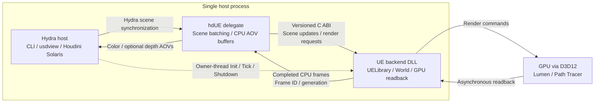

# hdUE

hdUE is a Windows x64 proof of concept for rendering OpenUSD scenes with Unreal Engine in the same process as a Hydra host. It provides a standalone host, usdview integration, and a Houdini Solaris viewport integration. Lumen is the default renderer; progressive Path Tracer rendering is also supported.

This repository contains the delegate, backend source, build scripts, synthetic samples, and tests. Local SDK installations, private projects, supplied content, generated runtimes, and machine-specific configuration are excluded. See [VERIFICATION.md](VERIFICATION.md) for validation coverage.

## System architecture



The host, delegate, and UE runtime share one process. The C ABI passes fixed-width data, handles, and caller-owned buffers. The host owns UE's lifetime; destroying a delegate releases its scene resources without restarting UE.

Hydra changes are batched and applied on the UE owner thread. Rendering and readback run asynchronously, and the delegate publishes completed frames without waiting for another Tick. Frame IDs and generation numbers prevent stale results from being presented as current. Solaris consumes both color and linear depth; the standalone path uses color by default.

## Requirements

- Unreal Engine **5.8.4** source: tag `5.8.4-release`, commit `f45729c0b6f097038e72b52d366a62baeca3275b`.
- Windows x64, MSVC, DirectX 12, and hardware ray tracing.
- OpenUSD **26.03** for the standalone host and usdview.
- Houdini **22.0.466**, with its bundled USD **26.05** and Python **3.13**, for Solaris.
- `uv` for all Python execution and dependency management.

The standalone and Houdini delegates use separate builds because their USD ABIs differ. The UE backend disables UE's USD and Python plugins. Dependencies retain their own licensing requirements.

## Local configuration

Run commands from the repository root. Store installation locations in the ignored `.local/paths.json` file, environment variables, or explicit script parameters. Fill in the values locally; do not commit them.

```json
{
  "engine_root": "",
  "editor_root": "",
  "openusd_root": "",
  "houdini_root": ""
}
```

| Local key | Environment variable | Script parameter |
| --- | --- | --- |
| `engine_root` | `HDUE_ENGINE_ROOT` | `-EngineRoot` |
| `editor_root` | `HDUE_EDITOR_ROOT` | `-EditorRoot` |
| `openusd_root` | `HDUE_OPENUSD_ROOT` | `-OpenUsdRoot` |
| `houdini_root` | `HDUE_HOUDINI_ROOT` or `HFS` | `-HoudiniRoot` |
| `runtime_config` | `HDUE_RUNTIME_CONFIG` | `-RuntimeConfig` |
| `review_scene` | `HDUE_REVIEW_SCENE` | `-InputUsd` |

Explicit parameters take priority over environment variables and local configuration. `HDUE_LOCAL_CONFIG` selects an alternative local configuration file. Relative values are resolved against that file's directory.

Keep private projects, scene-specific helpers, catalogs, runtime profiles, and review evidence in `.local/`, `external/`, or `out/`. These directories are ignored. The source under `unreal/HdUEBackend` remains version controlled; its generated Content and build products do not.

## Build and validation

```powershell
.\scripts\Setup-Engine.ps1
.\scripts\Verify.ps1
```

`Setup-Engine.ps1` obtains the pinned source using the user's own engine access. `Verify.ps1` builds the host, prepares synthetic UE content, builds the backend DLL, stages a runtime, runs rendering checks, and compares native UE and Hydra HDR images. Add `-WithUsdview` for GUI, camera, and buffer checks. `-SkipBuild` reuses compatible build and cook outputs.

Individual steps are available:

```powershell
.\scripts\Build-Host.ps1
.\scripts\Prepare-Content.ps1
.\scripts\Build-Backend.ps1
.\scripts\Stage-Runtime.ps1
```

The monolithic DLL requires a source engine. A matching editor installation can prepare content. Virtual-texture residency support adds one friend declaration through `Apply-ResidencyPatch.ps1`, which validates the engine version and insertion point. UELibrary and Launch are otherwise unchanged.

Fresh verification evidence is written under `out/`. A successful exit code alone is insufficient: tests require new images, metadata, and clean engine shutdown.

## Standalone rendering and usdview

```powershell
.\scripts\Test-Hydra.ps1 -InputUsd samples/smoke.usda -Mode both -Cycles 1
.\scripts\Launch-Usdview.ps1 -InputUsd samples/smoke.usda
.\scripts\Launch-Usdview.ps1 -InputUsd samples/smoke.usda -Mode pathtraced
```

The launcher owns UE initialization, Tick, and shutdown on the UI thread. Use it rather than an unmanaged usdview process. Asynchronous scene processing is unsupported.

Camera controls include orbit, pan, and dolly. Continuous updates are coalesced. Lumen retains its ViewState during camera motion; scene, material, time, resolution, and Path Tracer request changes reset accumulation.

The launcher supplies its own CPU picking path for generic meshes and supported native geometry. This is separate from standard Hydra ID AOVs and selection outlines. Native CPU picking requires readable, resident LOD0 data and rejects unsupported material deformation or Nanite overrides.

Optional camera-following review lights are used when there are no active supported scene lights. Authored lights take precedence. Review lights are intended for inspection, not calibrated illumination. Dome/HDRI lighting is not implemented.

## Houdini Solaris

Build the Houdini-specific delegate:

```powershell
.\scripts\Build-Houdini.ps1
```

After staging the repository backend, create a local runtime profile:

```powershell
$game = (Resolve-Path 'out/runtime/Windows/HdUEBackend').Path
New-Item -ItemType Directory -Force .local | Out-Null
@{
    version = 1
    backend_dll = Join-Path $game 'Binaries/Win64/HdUEBackend.dll'
    runtime_project = Join-Path $game 'HdUEBackend.uproject'
} | ConvertTo-Json | Set-Content .local/runtime.json -Encoding utf8

.\scripts\Update-HoudiniRuntime.ps1 -RuntimeConfig .local/runtime.json -SetDefault
.\scripts\Launch-Houdini.ps1 -InputUsd samples/smoke.usda
.\scripts\Test-Houdini.ps1
```

The update script places the current depth-capable DLL under a content-hash filename. `-SetDefault` records an ignored default profile. An explicit launch profile takes priority. Restart Houdini to change runtimes.

The launcher registers `Unreal Engine (hdUE)` for its process without editing the user's Houdini environment file. It creates a source layer and an `hdUE_settings` subnet. Lumen is the default mode; Path Tracer defaults to 64 samples. Standard tumble, pan, and dolly controls are used. A secondary image window is optional.

Output uses **Y-up and one unit per meter**. Normalization preserves prim paths, original transform interpolation, reset stacks, and camera optical dimensions. The subnet's source-axis and source-unit controls handle inputs whose metadata was lost during composition.

For an existing LOP output, replace `YOUR_OUTPUT` with a node in the current network and run this in Houdini's Python Shell:

```python
import hdefereval, hdue_houdini

def connect_hdue():
    node = hdue_houdini.settings_node(hou.node('/stage/YOUR_OUTPUT'))
    node.setDisplayFlag(True)
    node.setCurrent(True, clear_all_selected=True)
    hdue_houdini.activate()

hdefereval.execute_deferred(connect_hdue)
```

The deferred call runs on the UI owner thread. Selecting the renderer alone does not prepare a LOP network.

Color and real UE depth share a frame ID and generation. Solaris receives linear axial depth in stage units with `depthstyle: linear`. The current target is one active hdUE viewport with a centered perspective camera. Standard selection outlines, ID AOVs, precise native viewport picking, husk, and USD Render ROP integration are not implemented. Use the Scene Graph Tree for prim selection and editing.

### COP textures

Shader file inputs accept absolute Houdini node paths such as `op:/obj/geo1/copnet1/OUT[0]`. The suffix selects a Copernicus output port; the default is zero.

COP evaluation and EXR export run outside LOP cooks. Dirty and time-dependent outputs are checked approximately every 0.25 seconds. Changed images receive immutable content-hash paths and reset Path Tracer accumulation. Unchanged images are reused. Cache files and the helper ROP are removed on shutdown.

Copernicus color outputs use 32-bit float linear Rec.709 with the default OCIO configuration. Inputs marked `raw` bypass conversion. Custom configurations must supply the corresponding output colorspace. Legacy COP color-plane export requires integer frames.

Rendering currently connects these textures to base color. Direct MaterialX Image-to-Standard Surface/OpenPBR base-color connections receive a basic Preview Surface fallback while retaining the MaterialX terminal. Dynamic normal/roughness textures, alpha-to-opacity wiring, COP UDIM collections, and texture replacement inside cooked native materials are not implemented.

```powershell
.\scripts\Test-HoudiniOpTextures.ps1
```

## MaterialX and Substrate

The backend uses Substrate with Adaptive GBuffer, up to four closures and 128 bytes per pixel. Generic PBR materials use a Substrate Slab.

Full MaterialX rendering uses UE's editor-side Interchange importer to create native Substrate materials, followed by cook and staging. The runtime does not load USD or MaterialX importers. The usdview integration maps source materials to prepared native assets and applies supported public parameter edits.

```powershell
.\scripts\Import-MaterialX.ps1 `
  -Source @('samples/materialx/standard_surface.mtlx','samples/materialx/open_pbr_surface.mtlx') `
  -OutputDirectory out/materialx-import/review
.\scripts\Stage-Runtime.ps1
.\scripts\Launch-Usdview.ps1 `
  -InputUsd samples/materialx/showcase.usda -CameraPath /Camera `
  -MaterialXLibrary out/materialx-import/review/library.json
```

Inline USD graphs use `Import-UsdMaterialX.ps1` with `samples/materialx/inline.usda` and a fresh output directory. The supported subset includes Standard Surface, OpenPBR, color/vector images, float normal-map strength, UV0 coordinates, and color multiplication. Nested NodeGraphs and interfaces are resolved during preparation. Unsupported nodes, cycles, unresolved images, incompatible connections, extra UV sets, volume, and displacement are rejected.

Published scalar and color inputs can be edited without resending geometry. Structural or source-file changes require preparation, cook, staging, and restart. Dependency hashes detect stale registries. Texture overrides require prepared native texture paths. Full registry integration currently uses usdview; Solaris provides only the basic fallback described above.

### Reference-safe sample

Use `samples/materialx/showcase_solaris.usda` with Solaris Asset Reference. Its single default prim contains geometry, materials, lights, and cameras, and uses Y-up/meters. All 21 meshes retain bindings when referenced below another prim.

The original `showcase.usda` is a complete-stage sample. Its materials are outside the default geometry prim, so open it as a stage or sublayer. Referencing only the geometry prim drops its material bindings.

Regenerate the reference-safe scene through `uv run` with the configured Houdini Python executable and `scripts/generate_solaris_materialx_sample.py`. The original sample and MaterialX files remain unchanged. Solaris displays Preview Surface fallbacks, not the complete native MaterialX appearance.

### Normal maps and UDIMs

`samples/materialx/normal_udim_showcase/normal_udim.usda` contains synthetic color and normal UDIM fixtures. Prepare it with `Import-UsdMaterialX.ps1` and a fresh output directory.

Normal maps use raw vector images through the float normal-map node. Import disables sRGB, uses normal compression, and adjusts the green channel for the UV convention. Strength scales decoded XY components before normalization. Custom tangent frames and vector-valued strength are unsupported.

UDIM validation covers conventional numbering, power-of-two resolutions, common aspect ratio, mixed resolutions, sparse tile sets, coordinates, and dependency hashes. Arbitrary uncooked UDIM import at runtime is unsupported.

Path Tracer waits for all required streaming virtual-texture pages and mappings before accumulating. Planning and requests are spread across frames without synchronous file-I/O waits. Capacity limits and timeout fail rather than accumulating low-resolution images. The default pool is 128 MiB per physical format; adjust it when necessary. Runtime/adaptive virtual textures and automatic pool expansion are outside the current scope.

## Cooked native assets

Xform, Scope, or Mesh prims can specify a cooked object path through `hdue:asset`. The registry determines whether it is a StaticMesh, SkeletalMesh, Actor Blueprint, or Level. The repository-generated mesh can be referenced as follows:

```usda
def Xform "NativeMesh"
{
    custom string hdue:asset = "/Game/HdUE/SM_Nanite.SM_Nanite"
}
```

The bridge generates bounds proxies in its own layer. Native assets retain their pivot, material slots, and centimeter dimensions. Authored and parent transforms follow stage units without double unit conversion.

Transform, visibility, deletion, and re-creation are supported. Level transforms reload the instance. Virtual-texture waiting also covers native materials. Skeletal meshes use reference poses; Blueprint game progression, time synchronization, and World Partition coverage remain limited.

`Prepare-ProjectAssets.ps1` accepts explicit private content inputs and a required map. Keep all input projects, catalogs, generated scenes, and runtime profiles local and ignored. Resolve missing classes/plugins before claiming complete reproduction. The catalog-driven scene generator has no private asset paths embedded in its defaults.

## Opacity and glass

Generic `displayOpacity` maps to Substrate coverage. Constant values and identical values across another domain are supported; varying values are reduced with a warning. Opaque and translucent parents are selected accordingly.

Optical glass uses a local profile that selects meshes and supplies IOR, roughness, attenuation color/distance, thickness, and coverage. Optical properties are not inferred from display opacity. Real-time refraction uses a thickness approximation; Path Tracer follows geometry and absorption. Profiles and scene-specific generators stay local and ignored.

## ABI and lifetime

The base ABI in `include/hdue/bridge.h` remains 96 bytes. It uses fixed-width POD fields, UTF-8 strings, opaque handles, and caller-owned buffers. UE, USD, STL objects, exceptions, and memory ownership do not cross the DLL boundary.

Optional versioned extensions provide native assets, picking, material parameters, virtual-texture residency, depth, and viewport diagnostics. Calls validate versions, sizes, capacities, generations, and the owning thread.

UE initializes once per process. Delegate destruction releases scene resources; process shutdown stops UE. GPU readbacks use fences. Completed images are returned without waiting synchronously for another Tick; stale generations are discarded. AOV maps pin immutable snapshots until Unmap. Color uses RGBA float and HDR output uses PFM. Shared GPU images remain a future optimization.
