# Substrate Builder

Status: experimental implementation. Houdini VOP authoring, USD graph serialization, editor-side material generation, and Lumen/Path Tracer rendering are implemented. The owned Solaris regression passes eight interactive cases. This document describes the current interfaces and their limits; a working node connection alone does not qualify every possible shader graph.

## Purpose and scope

Substrate Builder lets artists compose UE Substrate materials in a Houdini VOP network. A prepared MaterialX surface can become an input to a larger graph. Slabs, coverage weights, and layer operators are authored explicitly. Water coating is an example network built from these nodes.

The initial implementation targets generic USD meshes in Solaris. Prepared graphs also render through the standalone Hydra host. Automatic Builder-library binding in stock usdview is a subsequent integration step; its existing MaterialX workflow remains available.

The renderer continues to use one UE instance in the host process. Shader graphs are compiled and cooked by a separate editor process. Solaris can prepare node/wiring edits in the background and install completed material variants without restarting Houdini or UE. Numeric/color inputs are generated as runtime parameters, so ordinary value edits and float masks do not recompile the graph.

## System structure

```mermaid
flowchart LR
    V["Houdini VOP network"] --> A["Substrate authoring LOP"]
    A --> U["USD Material and Shader graph"]
    U --> P["Graph validation and preparation"]
    X["Prepared MaterialX library"] --> P
    P --> E["UE Substrate material expressions"]
    E --> C["Cooked materials and Builder library"]
    U --> H["Host binding and parameter resolver"]
    C --> H
    H --> D["hdUE delegate"]
    D --> B["UE backend in the same process"]
    B --> R["Lumen / Path Tracer color AOV"]
    H --> Q["Coalesced graph-change queue"]
    Q --> W["Background editor compile / cook"]
    W --> I["Immutable packages with inline shader code"]
    I --> B
    W --> H
```



Houdini supplies the node editor, connections, parameters, and undo. hdUE exports its own typed graph. The Builder nodes are not a VEX implementation of Substrate and do not create a Karma material.

## Authoring in Houdini

Load the hdUE Houdini integration and add the **hdUE** shelf. The shelf provides:

- **Substrate Builder**: create an editable VOP network containing a Slab connected to the surface output.
- **Water Coating Example**: create a MaterialX base, clear water Slab, public coverage/roughness parameters, float mask, Weight, and Vertical Layer.
- **Author Substrate USD**: export the selected Builder through a Python LOP, using the current Scene Graph selection as material-binding targets.

The same operations are available in Houdini's Python shell:

```python
import hdue_substrate

builder = hdue_substrate.create()

# Optional example; set the MaterialX Surface node to an existing USD material.
water = hdue_substrate.create(
    preset="wet", material="/Looks/Base")

# Export into an override layer after the current displayed LOP.
hdue_substrate.publish(water)
```

`author_lop(builder, material_path, input_node, prim_paths)` provides explicit control over the output location. Its parameters select the VOP network, USD material path, and binding targets. Source USD files and referenced materials remain independently editable.

### Material Library placement

Substrate Builder can be created and edited inside a Material Library LOP's VOP network. Pass that LOP as the parent:

```python
import hou
import hdue_substrate

library = hou.node("/stage/materiallibrary1")
builder = hdue_substrate.create(parent=library)
output = hdue_substrate.author_lop(
    builder, "/Looks/Substrate", input_node=library)
```

The current USD export path is the dedicated authoring LOP after Material Library. Standard Material Library translation does not automatically export these custom VOPs; Builder materials deliberately have their Houdini material flag disabled. In the verified placement test, Material Library alone authored no Substrate material, and the following authoring LOP successfully created `/Looks/Substrate` without errors. Automatic discovery, material-path mapping, and export through Material Library's own controls require further integration.

Node definitions are generated from repository source into the ignored `out/substrate-builder` directory. Generated HDA files and HIP inspection scenes are local artifacts.

## Available nodes

| Node | Inputs / properties | Output |
| --- | --- | --- |
| MaterialX Surface | Existing USD Material path, resolved through the selected prepared MaterialX library | Surface |
| Substrate Slab | Diffuse albedo, F0, roughness, optional normal, mean free path; `none` or `simple_volume` subsurface mode | Surface |
| Substrate Weight | Surface and coverage weight | Surface |
| Substrate Vertical Layer | Top, base, thickness in UE centimeters; explicit parameter-blending option | Surface |
| Substrate Horizontal Mix | Background, foreground, mix; explicit parameter-blending option | Surface |
| Scalar Parameter | Public name and editable float value | Float |
| Color Parameter | Public name and editable RGB value | Color |
| Float Constant / Color Constant | Spatially constant value, editable at runtime | Float / Color |
| Float Multiply / Float Saturate | Numeric inputs | Float |
| Float Mask Primvar | Primvar base name and default value | Float |
| Float to Color | Replicate a scalar into RGB | Color |
| Substrate Unlit | Emission color; also used by generated mask-preview materials | Surface |
| Texture Sample | Image file or explicit `<UDIM>` pattern, `srgb` / `raw`, `wrap` / `clamp` / `mirror`, optional UV | RGB, RGBA, R, G, B, A |
| UV Coordinates | UV0 (`st`), two-component scale and offset | Vector2 |
| Extract Channel | RGBA input and `r` / `g` / `b` / `a` selector | Float |
| Normal Map | Encoded RGB, strength, Flip Green | Normal vector |

Surface connections use native VOP BSDF sockets. Numeric connections use float/vector sockets. The exporter validates its own port types and rejects unsupported implicit conversions or unrecognized VOP nodes.

The first graph format allows up to 256 connected nodes, one MaterialX Surface input, and one Float Mask Primvar node. Disconnected serialized nodes, cycles, incompatible ports, missing surface inputs, duplicate public names, reserved `HdUE_` parameter names, and non-finite numeric data are errors. Unconnected VOP work-in-progress branches are excluded from export.

### Direct texture connections

Texture Sample can connect its **RGB** (`out`) output directly to a Slab's Diffuse Albedo or F0. Connect its **RGBA** output to Extract Channel for packed roughness or coverage masks; alternatively use its individual R/G/B/A outputs. Image masks can drive Substrate Weight and mix inputs without a float-primvar overlay.

Use `srgb` for ordinary color images and `raw` for roughness, masks, and encoded tangent-space normal maps. A Normal Map node decodes RGB from [0, 1] to [-1, 1], scales XY by Strength, and normalizes the result. Flip Green defaults to enabled for OpenGL/MaterialX +Y maps because the mesh bridge converts V to UE's texture convention. Disable it for DirectX -Y maps. Connect the converted result to Slab Normal. Connecting an sRGB Texture Sample directly to Normal Map is rejected. Raw sources retain RGB/alpha using UE's uncompressed vector-displacement texture setting; this favors data fidelity over texture memory savings.

UV Coordinates applies `UV0 * Scale + Offset` in UE texture coordinates, after the mesh bridge's `st` V conversion. An unconnected Texture Sample UV uses UV0. Only the transported UV0 set is available; other indices are rejected. Scale and offset are live two-component parameters. Missing mesh UVs cannot supply a meaningful texture layout.

The file parameter uses Houdini's file picker and expands variables such as `$HIP`. VOP-relative paths are anchored to the HIP folder before USD export. USD stores the file as an asset attribute, so referenced layers retain their source-layer-relative resolution. Preparation snapshots the image inputs into its output folder, imports texture assets, and compiles materials that reference them. Color-space or address-mode variants get separate prepared texture assets.

An explicit `BaseName.<UDIM>.ext` or `BaseName_<UDIM>.ext` pattern imports all matching tiles. Multi-tile inputs use streaming virtual textures. Tile indices, source-block coordinates, membership, and source content are checked. A single tile must be 1001 and uses an ordinary 2D texture; a single off-origin tile is rejected. A literal numbered file remains a single 2D image. Existing virtual-texture residency checks gate Path Tracer accumulation. Direct Builder `op:` / `opdef:` image inputs require baking/exporting to image files first; the separate existing COP/MaterialX resolver does not automatically export these new nodes.

The [direct texture example](../samples/substrate/textures.usda) has one mesh and one composite material. An sRGB checker drives albedo, packed raw G drives roughness, packed raw A controls the top Slab's coverage, and a raw RGB image passes through Normal Map to the base Slab. `NormalStrength` is a live Scalar Parameter. No MaterialX base library is required for this scene.

```powershell
.\scripts\Prepare-Substrate.ps1 `
  -InputUsd samples/substrate/textures.usda `
  -OutputDirectory out/textures-prepared
```

`scripts/generate_substrate_textures.py` creates the owned image fixtures and USD scene. Its optional HIP output places the editable VOP network inside Material Library, followed by the dedicated authoring LOP.

To create a HIP from the existing supplied scene without regenerating its images, run the generator through the configured Houdini Python executable:

```powershell
. ./scripts/Local-Paths.ps1
$HoudiniPython = Join-Path (Get-HdUELocalPath houdini_root) 'bin/hython.exe'
uv run -- $HoudiniPython scripts/generate_substrate_textures.py `
  --scene samples/substrate/textures.usda `
  --hip out/texture-example.hip `
  --runtime-config .local/builder-runtime.json
```

The runtime profile must select the prepared library and a staged runtime containing its cooked assets. Generated HIPs retain the source image paths used for preparation.

## USD representation and identity

A Builder material has `hdue:substrate:version = 1`. Its `outputs:hdue:surface` connects to a typed USD Shader graph below the material. Shader identifiers have the form `hdue:substrate:slab`, `hdue:substrate:vertical`, or `hdue:substrate:scalar`. An ordinary Preview Surface output supplies a basic fallback before preparation.

MaterialX Surface inputs use a relationship to the source USD Material. USD composition remaps that relationship when the enclosing asset is referenced below another root. A plain string containing an absolute prim path would not provide that behavior.

Graph signatures include operators, wiring, public parameter names, and static options such as parameter blending and subsurface mode. Numeric/color input values, Float/Color Constant values, UV scale/offset, Normal Map Flip Green, Extract Channel selection, Float Mask Primvar fallback values, public scalar/color values, and the selected mask name are excluded from the structural signature. The editor emits scalar/vector material parameters with stable reserved `HdUE_Auto_` names for automatic inputs. The host updates these values on material instances. Connected inputs continue to evaluate their upstream nodes; their unconnected fallback fields do not override a connection. The prepared MaterialX input has a separate dependency identity; replacing its graph or imported dependencies requires preparing the composite material again.

Texture asset paths, color space, address mode, UV set index, and selected output sockets remain static graph inputs. Source hashes and UDIM membership are stored in the prepared library and checked when loading it. Replacing an image or changing its tile set requires preparing, cooking, and staging again; filenames are not runtime texture parameters.

Automatic parameters use compiler version 2 in preparation manifests and libraries. Previously prepared materials must be rebuilt, cooked, and staged once to obtain the generated parameters. A library from the earlier compiler produces an explicit preparation message instead of accepting value edits that its cooked shader cannot apply. Existing USD graphs and editable VOP assets retain their graph schema version.

The generated Builder library records the graph signature, MaterialX dependency identity, cooked material, and cooked mask-preview material. It is local generated data and belongs outside Git.

## Preparation, cook, and launch

Configure the SDK and engine locations in ignored local configuration as described in the repository README. Prepare the MaterialX input before composing it in a Builder graph. For the supplied example:

```powershell
.\scripts\Import-MaterialX.ps1 `
  -Source @('samples/materialx/standard_surface.mtlx', 'samples/materialx/open_pbr_surface.mtlx') `
  -Destination /Game/HdUE/BuilderBase `
  -OutputDirectory out/builder-base -SkipCook

.\scripts\Prepare-Substrate.ps1 `
  -InputUsd samples/substrate/contrast.usda `
  -MaterialXLibrary out/builder-base/library.json `
  -OutputDirectory out/builder-prepared

.\scripts\Build-Backend.ps1
.\scripts\Build-Houdini.ps1 -BuildDirectory build/houdini-substrate
.\scripts\Stage-Runtime.ps1 -OutputDirectory out/builder-runtime
```

Choose fresh preparation output directories. `Prepare-Substrate.ps1` exports and validates the USD graphs, runs the `HdUESubstrate` commandlet, builds a library from its receipts, and cooks the generated assets. `-SkipBuild` and `-SkipCook` are available for controlled iteration. This remains the initial/manual preparation path; Solaris topology edits can use the background path below.

Save an ignored `.local/builder-runtime.json` profile. Relative paths are resolved from the profile's directory:

```json
{
  "version": 1,
  "backend_dll": "../out/builder-runtime/Windows/HdUEBackend/Binaries/Win64/HdUEBackend.dll",
  "runtime_project": "../out/builder-runtime/Windows/HdUEBackend/HdUEBackend.uproject",
  "materialx_library": "../out/builder-base/library.json",
  "substrate_library": "../out/builder-prepared/library.json"
}
```

Launch a new host process with the staged backend/runtime project and both libraries:

```powershell
.\scripts\Launch-Houdini.ps1 `
  -RuntimeConfig .local/builder-runtime.json `
  -BuildDirectory build/houdini-substrate `
  -InputUsd samples/substrate/contrast.usda `
  -MaterialXLibrary out/builder-base/library.json `
  -SubstrateLibrary out/builder-prepared/library.json
```

The local runtime profile selects `backend_dll` and `runtime_project`. Its optional `materialx_library` and `substrate_library` keys provide default library selections. Solaris exposes **Cooked MaterialX library**, **Prepared Substrate library**, and the mask-preview toggle in the hdUE settings subnet. Staging into a fresh folder preserves the binaries used by an existing host.

The standalone host accepts a resolved settings snapshot generated by `scripts/prepare_renderer_settings.py --substrate-library ...`. Pass that file to `Test-Hydra.ps1 -RendererSettings` or `hdue_usd_render --renderer-settings`. Regenerate the snapshot after changing the authored Builder settings; live VOP editing is handled by Solaris.

## Editing and rendering

| Edit | Required work |
| --- | --- |
| Numeric/color input value on any node, including Slab color/F0/roughness/MFP, Weight/Mix, and layer thickness | Update generated native material parameters and start a new render generation |
| UV scale/offset, Normal Map strength/Flip Green, Extract Channel selection, constant value, or Float Mask fallback | Update generated native material parameters and start a new render generation |
| Scalar Parameter or Color Parameter value | Update public native material parameters and start a new render generation |
| Float Mask Primvar name or samples | Resolve/re-expand the selected mask and update the relevant color buffers |
| Mesh topology, material binding, or transform | Synchronize the affected scene resources and matching mask revision |
| Node type, wiring, public parameter name, subsurface mode, or blending option | Background compilation/cook and material replacement in Solaris; manual preparation elsewhere |
| MaterialX source graph or imported texture dependencies | Re-prepare the MaterialX input and its Builder material |
| Builder image path, color space, or address mode | Background preparation in Solaris when the graph signature changes |
| Image bytes or UDIM membership changed without a USD graph edit | Manually refresh preparation; file contents alone do not invalidate the topology cache |

Public parameters are shared by prims bound to the same USD material. Masks vary independently on each mesh or material-binding GeomSubset. Use separate material instances/material prims when independently authored public parameter values are needed.

The authoring LOP reads connected VOP parameters through native Houdini cook dependencies. Structural events (rewiring and child creation/deletion) increment a hidden authoring revision parameter because deep VOP wiring changes are not reliably tracked by parameter dependencies alone. Event handlers never force a synchronous cook. Both value edits and bursts of structural edits settle through Houdini's scheduler at the next evaluation. Saved author LOPs without the revision parameter are upgraded automatically.

An edit that requires preparation pauses the current request and reports progress in Houdini's status bar. The last valid displayed AOV remains visible, but the pending request exposes no completed frame. Identical statuses are published once per session instead of being resubmitted on every material poll. Successful background preparation or restoring a cached graph resumes rendering.

Disconnecting a required surface or output is represented by an `hdue:substrate:authoringError` material attribute while retaining a valid LOP stage. It pauses the requested material without terminating the host timer or starting an invalid compiler job. Reconnecting clears that attribute and resumes validation. A valid topology change, including disconnecting an optional numeric input, is prepared in the background. Disconnected inputs explicitly clear weaker USD connections so the original source/reference cannot silently reconnect them. Unrelated LOP stage-read errors are recoverable and do not terminate UE ticking.

### Background graph preparation in Solaris

**Prepare graph edits automatically** is enabled by default in the hdUE settings subnet. Existing saved settings nodes are upgraded when opened through the integration. **Retry material preparation** retries a failed graph after correcting a missing source or toolchain problem. Disabling automatic preparation retains the manual library workflow.

The worker requires the configured OpenUSD SDK, uv-managed Python runtime, UE editor, and a previously built `HdUESubstrate` commandlet in this repository's backend project. The worker uses standalone USD Python with isolated plugin paths so the GUI host's Houdini USD environment cannot leak into preparation. It snapshots only typed material graphs and their resolved base-material identities; geometry is not copied to the worker. Graph edits settle briefly before a single worker starts. Editor/cook work is serialized for this checkout, and only the latest requested graph is queued while a previous job is running.

Each result uses a fresh `/Game/HdUE/Live/...` package namespace. A focused cook writes to an isolated output directory with material shader-code sharing disabled. Shader code is embedded in the new cooked packages, so the active runtime's already-open shared shader libraries are never replaced. The completed payload is atomically added to the staged runtime's loose Content directory; the current generic material binding API loads the new material and creates its runtime instances. This path requires writable, loose cooked content on the supported Windows runtime. It does not update pak/IoStore deployments or arbitrary external editor projects.

The running UE instance continues ticking while the editor compiles. The resolver binds a result only when it matches the current USD graph. Superseded results can enter the variant cache but cannot replace a newer edit. Public and generated parameter values are read from the latest USD state after compilation, preserving value edits made while the job was running. Returning to a prepared/cached topology does not start another cook. Path Tracer starts a new generation after replacement and the existing material/texture readiness checks.

Compilation is asynchronous rather than instantaneous. Progress and failures appear in Houdini's status bar, `runtime-state.json`, and the session's `substrate-live` output directory. Failed graphs retain the last valid display and retry on a different topology or the retry button. In-flight editor jobs are allowed to finish their immutable output if the host closes. Generated variants are cached for the process and are not automatically unloaded or deleted.

Runtime material instances retain the prepared graph and its base texture parameters. Per-mesh mask instances are isolated. The optional surface C ABI copies caller data, validates the session and geometry revision, and publishes updates on the owner thread. A mask-selector edit can fetch a newly selected primvar from the synchronized Hydra delegate using cached triangulation, without requiring a geometry upload.

Path Tracer accumulation is reset after relevant edits. It starts after material/mask publication and required virtual-texture residency are ready. Older image generations are discarded. A missing mask or unprepared graph produces a specific error and does not qualify as a completed render of the requested material.

## Float masks

The initial transport reserves the dynamic mesh color overlay's red channel. Values are linear normalized data in [0, 1], with no sRGB conversion. GPU color storage may quantize to 8 bits; this is a mask transport, not a general unbounded-float primvar implementation.

Supported inputs are float scalar constant primvars and float-array constant, uniform, vertex/varying, or face-varying primvars. Indexed arrays are flattened before use. Triangulation and GeomSubset partitioning preserve the source domains and face discontinuities. A configured missing primvar, invalid count/type/index, or NaN/Inf is an error. An empty name uses the node's compiled default value.

Mask-only updates use color-buffer notifications. They do not upload positions, indices, normals, or UVs. Topology changes create a new geometry revision; updates targeting an obsolete revision are rejected.

## Water coating example

Use `samples/substrate/contrast.usda` for visual comparison. All three spheres share the composite material, with masks of 0, 1, and a split transition. The base MaterialX coat is overridden to 0 and its specular roughness to 0.65; the water roughness remains 0.08. This makes the change in reflection width easier to inspect while preserving the base color. `scripts/generate_substrate_comparison.py` generates the scene and can optionally create a Material Library HIP or a single-mesh variant. Published base-parameter overrides use the existing prepared library and do not require a new shader cook.

The older `showcase.usda` uses a base with coat weight 0.9 and coat roughness 0.07. Its water layer has similar roughness, so the three coated/checker surfaces can look similar. Controlled same-camera coverage-0/coverage-1 renders confirm that the effect changes the image; similar appearance alone does not establish a missing binding. The original scene remains useful for the existing-coat regression.

The three spheres represent dry, uniformly coated, and masked results. Each coated sphere evaluates its base BSDF and water Slab inside one composite material on that mesh. The water layer does not require a second geometric surface. The older showcase's Ramp sphere also contains a GeomSubset binding regression; any backend partitioning for that subset is independent of Slab layering. The contrast scene has no GeomSubsets. A single-mesh inspection variant has also been verified with one rendered mesh and one assigned material in both Lumen and 64-sample Path Tracer output.

The supplied network places a clear dielectric Slab above the original MaterialX front material. It uses IOR 1.33 converted to F0, roughness 0.08, a mean free path large enough to avoid an artistic absorption tint, and a 0.01 cm top-layer thickness. Coverage is the product of the saturated public amount and the float mask. The base normal-map graph is retained; the top slab uses the mesh shading normal unless another normal is connected.

These values belong to the example graph. Artists can change its nodes, expose additional parameters, or construct another surface entirely. Layer thickness is expressed in UE centimeters and is independent of the USD stage's meters-per-unit setting.

## Limits and validation

The current backend uses Adaptive GBuffer with a four-closure, 128-byte-per-pixel budget. The owned MaterialX water example compiles to three closures and 92 bytes per pixel; its base compiles to two closures and 64 bytes. Arbitrarily complex graphs require separate qualification. Parameter blending is an explicit authored choice.

Initial support covers opaque graphs on generic USD meshes. Native uasset material slots, arbitrary UE material expressions, multiple MaterialX bases, multiple float-primvar mask channels, unbounded float buffers, full transmission/glass authoring, volume/displacement, and compiling shaders inside the rendering DLL are outside this implementation. Existing prepared MaterialX textures remain on the imported graph. Direct Texture Samples additionally support image masks; Float Mask Primvar continues to use the separate per-mesh overlay transport. Additional UV sets, direct COP/opdef baking, and dedicated BC5 normal-map compression are outside the direct-texture implementation. Background topology preparation currently targets Solaris and this repository's loose-content backend runtime.

Current checks cover typed graph validation, float32 USD round trips, remapped MaterialX relationships, native VOP-to-USD parameter updates, both SDK builds, and Lumen/64-sample Path Tracer output through repeated delegate sessions. The eight-case Solaris regression passes public coverage/roughness edits, preparation-error recovery after a structural edit is reverted, mask-only updates, and preview restoration. Generated logs, images, shader receipts, and HIP files remain under ignored output directories. No hardware-independent performance target is claimed.

Direct textures additionally pass 18 numerical color-AOV checks across Lumen and 64-sample Path Tracer: sRGB versus raw values, all four extracted channels, the direct alpha socket, and two UDIM tiles selected using UV offsets. The 15-image Solaris regression verifies direct Slab values, live UV transforms, channel selection, Flip Green, both render modes, settled preparation errors, required/optional wire disconnects, reconnection, and live edits after reconnection. A 100-edit burst produces one authoring cook in the headless dependency test and at most two in the Solaris regression, without geometry/mask uploads. The native host self-test verifies that a preparation error stops the render-pass update loop without publishing a completed frame and that clearing the error resumes it. The direct-texture example compiles to two closures and 52 bytes per pixel on the tested configuration.

The eight-case background-topology regression passes node addition, generated parameter updates on the new material, Lumen and 64-sample Path Tracer replacement, a newer edit queued during compilation, rejection of superseded display results, cached topology restoration, and incomplete-connection recovery. Three worker jobs complete with the same Houdini process, Hydra session, and one UE initialization. Unit checks cover single-flight queue ordering, failure/retry behavior, worker environment isolation, and atomic publication without replacing an existing live package directory.

Implementation entry points:

- [VOP definitions and authoring LOP](../integrations/houdini/python3.13libs/hdue_substrate.py)
- [Typed graph and USD contract](../scripts/substrate_graph.py)
- [Texture resolution and preparation](../scripts/substrate_textures.py)
- [Numerical texture/UV/UDIM render checks](../tests/substrate_texture_render.py)
- [Background queue and variant cache](../scripts/substrate_live.py)
- [Isolated compile/cook worker](../scripts/Prepare-SubstrateLive.ps1)
- [Same-process topology regression](../integrations/houdini/python3.13libs/hdue_substrate_live_test.py)
- [Preparation command](../scripts/Prepare-Substrate.ps1)
- [UE expression compiler](../unreal/HdUEBackend/Source/HdUEContent/Private/HdUESubstrateCommandlet.cpp)
- [Runtime library resolver](../scripts/substrate_library.py)
- [Solaris regression](../integrations/houdini/python3.13libs/hdue_substrate_test.py)
