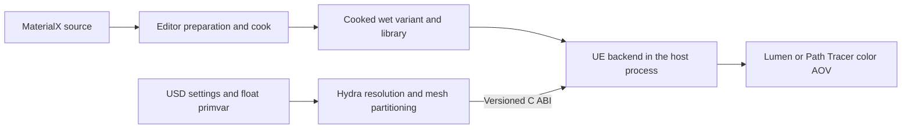

# Wet surface layer specification

Status: historical Draft 0.1. The fixed-profile product direction has been superseded by [Substrate Builder](substrate-builder.md), which is the current authoring and implementation document. This file preserves the original water-coating requirements; its proposed UI and interfaces are not the current Builder contract.

The first release adds a thin water coating above a prepared MaterialX surface. Artists control its coverage on USD meshes with a scalar amount and an optional float primvar authored in Houdini. The base material, its bindings, and referenced source files remain independently editable.

The agreed starting scope is a Substrate coating, MaterialX materials on generic USD meshes, and float primvar masks. The detailed defaults and interfaces below are proposed implementation contracts.

## User workflow

1. Prepare a MaterialX library with the wet profile enabled, then cook and stage the resulting materials.
2. Load the USD scene in the existing hdUE host and select the matching library.
3. Enable the wet effect on a Mesh or an ancestor Xform. Choose a mask primvar or apply a uniform amount.
4. Edit the amount, coating roughness, or primvar values while inspecting Lumen or Path Tracer output.
5. Disable the effect to return to the original prepared material.

A graph/profile change requires preparation, cook, staging, and runtime restart. Amount, roughness, mask values, and placement changes do not require shader compilation. The existing same-process host and UE lifetime remain in use.

## First release scope

| Area | Contract |
| --- | --- |
| Base surfaces | Prepared Standard Surface and OpenPBR reflection materials with opaque blend mode |
| Base details | Preserve base color, metallic response, roughness, existing coat, normal maps, and prepared UDIMs |
| Geometry | Generic USD meshes, material-binding GeomSubsets, and expanded instanceable references |
| Mask input | Uniform amount, or a named float primvar on the target mesh |
| Rendering | Lumen and Path Tracer using the same generated material graph |
| Coating count | One wet coating above the entire original surface graph |

Subsurface/fuzz profiles, transmission/glass, masked/translucent blend modes, hair/eye shaders, arbitrary cooked uasset materials, native asset material slots, image/COP/UDIM masks, puddle geometry, droplets, animated ripples, absorption tint, and thin-film interference are deferred. Existing normal and UDIM textures in the base material remain supported; the new wet mask itself is a float primvar.

Only qualified base graphs are accepted. Preparation records the supported capabilities and validates the combined graph against the backend's closure and storage budgets. An incompatible graph produces a specific error rather than substituting a cheaper material without notice.

## Water coating model

The graph retains the original Substrate front-material expression as its bottom input. A clear dielectric Slab forms the top input. Substrate Coverage Weight controls the top slab's coverage, and Substrate Vertical Layer composes it above the bottom graph. These are graph operators; this design does not depend on the Material Layers authoring UI. [Epic Substrate overview](https://dev.epicgames.com/documentation/unreal-engine/overview-of-substrate-materials-in-unreal-engine)

The proposed wet profile has:

- A fixed interface IOR of 1.33, converted to the appropriate Substrate reflectance input during preparation.
- Clear transmission through the coating, with no artistic absorption tint or diffuse water lobe.
- A fixed coating thickness of 0.1 mm, converted to 0.01 cm for the UE graph. Stage units and object scale do not change this profile thickness.
- An editable coating roughness, default 0.08.
- The interpolated mesh shading normal for the coating. The bottom graph retains its original normal-map evaluation; the coating does not flatten or overwrite that graph.

The amount describes fractional surface coverage, not water depth. The final coverage is:

```text
coverage = saturate(amount) * saturate(mask)
```

An empty mask name selects a constant mask of 1. Coverage 0 selects the dry surface; coverage 1 applies the full coating. Intermediate values expose both dry and coated surface areas through the Substrate coverage operator. No automatic base-color darkening is added in this release.

Parameter blending is disabled in the first shader proof of concept so that the coating remains a separate slab. The implementation must verify that compilation retains the intended layering within the configured budgets. The current backend uses four closures and 128 bytes per pixel; an original material already consuming its budget may not accept another slab. Automatic budget increases and silent simplification are outside this release.

## USD authoring contract

The following attributes are authored on a Mesh, its material-binding GeomSubset, or an ancestor Xform/Scope. They are renderer-specific settings and do not modify the MaterialX graph.

| Attribute | Type | Default | Meaning |
| --- | --- | --- | --- |
| `hdue:surface:wet:enabled` | bool | false | Enable the wet profile for the target binding |
| `hdue:surface:wet:amount` | float | 1 | Overall coverage multiplier, in [0, 1] |
| `hdue:surface:wet:roughness` | float | 0.08 | Roughness of the water coating, in [0, 1] |
| `hdue:surface:wet:maskPrimvar` | token | empty | Primvar base name, for example `wetness`, without `primvars:` |

hdUE resolves each setting from the nearest authored opinion, starting at a subset, then its mesh, then ancestors, followed by the default. This is an explicit hdUE ancestor search: ordinary custom USD attributes do not acquire this inheritance automatically. Normal USD composition determines the winning opinion at each prim. Values may be time sampled.

A child `enabled = false` disables an inherited effect. An explicitly empty mask name requests uniform coverage even when a parent selected a mask. Settings on a referenced asset's placement prim apply to its contained supported meshes without editing the referenced file. Masks are evaluated on the owning mesh, including when a subset selects a different mask name.

This override-layer example assumes an existing four-point mesh with a prepared MaterialX binding:

```usda
#usda 1.0

over "World"
{
    over "Asset"
    {
        custom bool hdue:surface:wet:enabled = true
        custom float hdue:surface:wet:amount = 0.8
        custom float hdue:surface:wet:roughness = 0.08
        custom token hdue:surface:wet:maskPrimvar = "wetness"

        over "Panel"
        {
            float[] primvars:wetness = [0, 0, 1, 1] (
                interpolation = "vertex"
            )
        }
    }
}
```

## Mask interpretation

Accept float scalar constant primvars and float-array constant, uniform, vertex/varying, and face-varying primvars. Indexed primvars must be resolved before use. Standard inherited constant primvars may be used when supplied by the USD/Hydra delegate. Values are linear data and receive no color-space conversion.

Resolve masks against the original USD face and point domains, then triangulate and partition with the same mapping used for geometry. GeomSubset splits must preserve mask values on the appropriate triangles, including discontinuities at face-varying boundaries. Generated normals and material boundaries must not change the mask's meaning.

Clamp finite samples to [0, 1]. Reject a requested missing primvar, an unsupported type/interpolation, invalid indices/counts, and NaN/Inf values. An unconfigured mask is uniform; a configured but missing mask is an error.

The proposed first GPU transport is a reserved red channel in the dynamic mesh's color overlay. It must not overwrite authored USD `displayColor` or its material semantics. CPU values remain float; normalized 8-bit GPU storage is acceptable for this release, with mask error no greater than 1/255 before shading interpolation. If the backend cannot preserve these linear values, the mask transport proof of concept must select another representation before integration.

Mask-only changes update attribute buffers rather than resending positions, topology, normals, and UVs. A topology edit re-expands the mask and associates it with the new geometry revision. An update for an obsolete revision is rejected.

## Preparation and material identity

Preparation generates a wet-capable material variant for each eligible base graph. The variant connects the original front material below the water slab and publishes reserved wet amount, roughness, and mask-selection parameters. Original published MaterialX parameter bindings remain available on the variant.

The library gains an additive, versioned wet-profile capability record containing the profile version, cooked variant asset, base identity, parameter mapping, mask transport, and validation results. Libraries without that record continue to render their base materials but cannot claim wet-profile support.

The variant cache key includes the base graph/static inputs and dependencies, wet-profile version, backend/engine shader configuration, and target platform. It excludes prim paths, amount, roughness, and mask sample values. Machine-specific source locations stay in ignored local configuration and generated registries.

At runtime, a mesh/subset binding receives its own effect instance identity scoped to the session and rendered object. Two prims sharing one USD material may use different wet settings without changing one another. The compiled variant and base textures may be shared; mutable material state and masks must remain isolated. Removing a prim or recreating a delegate releases its effect resources.

A disabled effect or uniform zero amount binds the original dry material. Removing an effect restores the original binding. A mixed mask uses the generated coating graph, including at pixels where the mask is zero.

## Runtime synchronization



The host/preparation adapter resolves the authored USD settings after reference composition and supplies an explicit effect-binding map to the delegate. Custom USD attributes are not assumed to appear automatically in `HdSceneDelegate::Get`. Each host must supply the same resolved contract through its renderer-settings or scene adapter. The delegate reads the selected mask primvar through Hydra and expands it with the geometry. A mask-name change must invalidate the relevant primvar data even when point positions are unchanged.

Parallel Sync work is accumulated into batches. The owner thread validates and applies each batch, then the render thread consumes the resulting resources.

The existing base ABI remains unchanged. An optional versioned extension must carry effect bindings and mask updates with fixed-width fields, caller-owned data, a session handle, and a geometry revision. Exact C structure layouts are settled after the shader/mask proofs of concept. Scalar/vector updates should reuse existing material parameter facilities where possible.

For each affected binding, validate the complete material/mask update before publishing it. Copy caller data during the call. Never expose UE/USD objects across the boundary. A backend lacking the extension reports an unsupported effect instead of silently ignoring authored wet settings.

Amount, roughness, mask, binding, topology, and relevant time changes advance the render generation and invalidate Path Tracer accumulation. Camera-only motion must not rebuild/cook a material or upload an unchanged mask. Geometry updates must retain or reapply the matching mask.

Path Tracer begins a new accumulation only after the effect instance, mask upload, and all required base-material virtual-texture residency are ready. Existing generation checks discard stale images. Time is held fixed during accumulation.

## UI and diagnostics

Solaris exposes an authoring control for a prim selection: enable, amount, roughness, and mask primvar. This writes an override layer on the selected prim paths, rather than changing a shared USD material. Authoring and undo stay on the Houdini UI thread. usdview/standalone may consume the same authored attributes without a dedicated painting UI.

A mask-preview color mode displays the final coverage in grayscale. It uses the ordinary color AOV and does not require a new public AOV. Returning to the shaded view restores the current effect/material binding.

Diagnostics identify the affected prim/subset and material, resolved setting sources, mask interpolation/count, wet-profile status, and the failed validation condition. Users must be able to distinguish an unprepared variant from an invalid mask or an unsupported base surface.

While a valid update is pending, keep a valid image/resource combination. On validation failure, retain the last valid effect only if its base binding and geometry revision still match; otherwise show the current dry material with an explicit effect error. Failed or pending wet requests must not be reported as successfully converged wet renders. Disabling the effect clears its failure and allows ordinary dry rendering.

## Acceptance criteria

| Test | Required result |
| --- | --- |
| Dry identity | Disabled/zero-amount bindings use the original material and original public parameter values |
| Uniform coating | Coverage 1 produces the intended water slab above the base; 0.5 is a stable partial-coverage result |
| Mask domains | Constant, uniform, vertex/varying, face-varying, and indexed inputs agree with their USD face/point domains |
| Mask preview | Values 0, 0.5, and 1, a ramp, and hard face boundaries appear in the correct places within the transport tolerance |
| Shared materials | Two prims sharing a base material retain independent wet amounts, roughness, and masks |
| References and subsets | Placement-prim overrides, renamed reference roots, instance expansion, subset edits/removal, and parent transforms preserve the intended result |
| Base details | Normal maps, metallic response, existing coat, and prepared UDIM tiles survive the added water slab |
| Live edits | Amount, roughness, and mask edits change a new delivered image without shader compilation; mask-only changes avoid geometry uploads |
| Synchronization | Stale geometry revisions are rejected; topology/resize/delete/recreate cases do not reuse incorrect mask buffers or material instances |
| Path Tracer | Zero new samples before all resources are ready; edits reset accumulation; a valid request reaches 64 samples and reports convergence |
| Native comparison | Generated native UE and Hydra renders use matched cameras, lights, time, seeds, and sample counts; the owned comparison fixture stays below 1% normalized RGB RMSE |
| Failure and recovery | Missing variants/masks, invalid data, wrong sessions/threads, and unsupported bases produce actionable errors; disable/fix/undo recovers |
| Lifetime and privacy | Repeated delegates keep one UE initialization; resources are released; source layers/files and publication rules are preserved |

Record preparation/compile time, first ready frame, scalar-edit latency, mask upload bytes/time, frame time in both modes, shader closure/storage cost, and VRAM. Compare with the same dry scene on the same hardware. Performance claims require these measurements; the first release does not set a hardware-independent FPS target.

## Implementation sequence

1. Shader proof of concept: compose the water slab above an imported opaque base, verify coverage endpoints, retained base details, and closure/storage budgets in both renderers.
2. Mask transport proof of concept: carry a procedural ramp through a dynamic mesh, verify linear values and face discontinuities, and exercise updates without topology uploads.
3. Integration: add the cooked profile record, binding isolation, USD settings resolution, optional C ABI, revision tracking, and residency gating.
4. Artist workflow and regression: add Solaris controls, mask preview, owned fixtures, reference/GeomSubset cases, recovery tests, and native comparisons.

Shader composition and mask transport are the first technical gates. If either gate fails its contract, revise this specification with the measured limitation before expanding the implementation. Dust, snow, image masks, native asset slots, and multiple ordered coatings follow the first wet-profile release.
